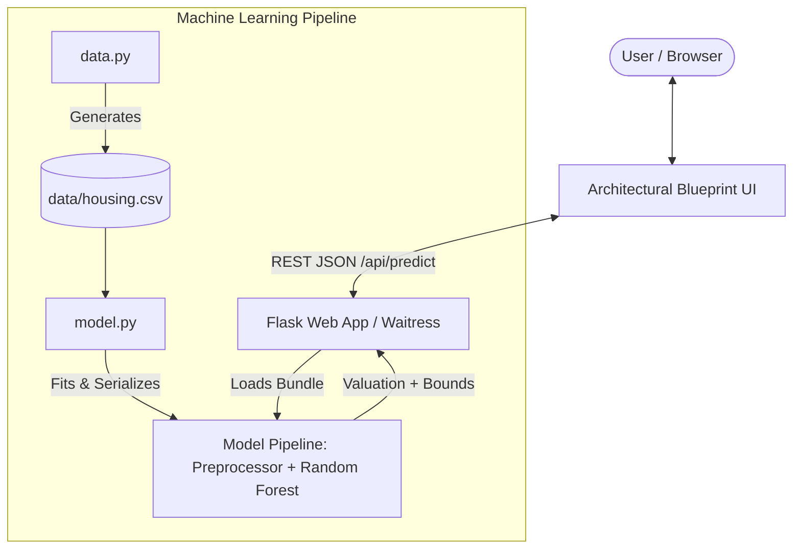

# 🏠 Appraised — House Price Prediction System

[](https://www.python.org/)
[](https://palletsprojects.com/p/flask/)
[](https://scikit-learn.org/)
[]()
[](LICENSE)

> **A structural machine learning valuation engine drafted from architectural specifications, featuring real-time CAD blueprint visualization and interactive regression estimation.**

---

## 📌 Table of Contents

- [Overview](#-overview)
- [Key Features](#-key-features)
- [System Architecture](#-system-architecture)
- [Machine Learning Pipeline](#-machine-learning-pipeline)
  - [Feature Set](#feature-set)
  - [Model Performance](#model-performance)
- [Project Structure](#-project-structure)
- [Quick Start & Installation](#-quick-start--installation)
  - [Prerequisites](#prerequisites)
  - [Step-by-Step Setup](#step-by-step-setup)
- [API Reference](#-api-reference)
  - [POST /api/predict](#post-apipredict)
  - [GET /api/meta](#get-apimeta)
  - [GET /api/health](#get-apihealth)
- [Architectural Presets](#-architectural-presets)
- [Self-Healing & Auto-Training](#-self-healing--auto-training)
- [License](#-license)

---

## 📖 Overview

**Appraised** is an end-to-end Machine Learning web application designed to calculate fair market values for residential properties based on structural, dimensional, and qualitative housing specifications. 

Modeled after the benchmark **Ames Housing Dataset**, the system pairs an ensemble **Random Forest Regressor** with a unique **architectural blueprint (CAD) interface**. As users calibrate parameters—such as square footage, room configurations, construction vintage, and neighborhood—an interactive SVG blueprint updates in real time, accompanied by confidence-bounded valuation estimates ($\pm \text{MAE}$).

---

## ✨ Key Features

- 🌐 **Bilingual Output (English & Hindi)**: Instant toggle between English and Hindi (`हिन्दी`) for all prediction outputs, natural language valuation summaries, CAD schematic dimension callouts, and UI controls.
- 📐 **Interactive CAD Blueprint Schematic**: Dynamic SVG rendering responds live to floor area, multi-story configurations, garage bay sizing, bathroom/bedroom callouts, and fireplace chimneys.
- 🌲 **Robust Ensemble ML Model**: Employs a Scikit-Learn `RandomForestRegressor` with 300 estimators and strict preprocessing pipelines via `ColumnTransformer`.
- 🔁 **Self-Healing Startup**: Automatically detects missing datasets or model artifacts on startup, generating synthetic data and fitting the model pipeline without manual intervention.
- 🎯 **Confidence Range Estimation**: Generates point estimates along with low-to-high valuation ranges derived from holdout Mean Absolute Error ($\pm \text{MAE}$).
- 🏛️ **One-Click Architectural Archetypes**: Rapidly test standard configurations including *Starter Ranch*, *Suburban Colonial*, and *Luxury Estate*.
- ⚡ **Production-Grade Serving**: Ready for deployment with the multi-threaded `Waitress` WSGI server, with automatic fallback to Flask development mode.
- 🔌 **Standardized REST API**: Fully validated JSON endpoints for programmatic estimations (supporting `en` and `hi`), metadata inspection, and system health checks.

---

## 🏗️ System Architecture



---

## 🧠 Machine Learning Pipeline

The estimation pipeline is encapsulated inside a reusable Scikit-Learn `Pipeline` composed of:
1. **Preprocessor (`ColumnTransformer`)**:
   - **Numeric features**: Direct passthrough normalization.
   - **Categorical features**: `OneHotEncoder` with `handle_unknown="ignore"` to safeguard against unseen categories during inference.
2. **Regressor (`RandomForestRegressor`)**:
   - 300 estimators with `min_samples_leaf=2` to curb overfitting while preserving non-linear interactions.

### Feature Set

| Feature | Type | Description | Example / Range |
|---|---|---|---|
| `GrLivArea` | Numeric | Above-ground living area (sq ft) | 400 – 5,000 sq ft |
| `LotArea` | Numeric | Total lot size (sq ft) | 1,500 – 50,000 sq ft |
| `TotalBsmtSF` | Numeric | Total basement area (sq ft) | 0 – 3,000 sq ft |
| `OverallQual` | Numeric | Material & finish quality rating | 1 (Very Poor) – 10 (Very Excellent) |
| `OverallCond` | Numeric | Overall condition rating | 1 (Poor) – 10 (Excellent) |
| `YearBuilt` | Numeric | Original construction year | 1900 – 2024 |
| `BedroomAbvGr` | Numeric | Number of bedrooms above grade | 1 – 6 |
| `FullBath` | Numeric | Full bathrooms above grade | 1 – 4 |
| `HalfBath` | Numeric | Half bathrooms above grade | 0 – 2 |
| `GarageCars` | Numeric | Garage car capacity | 0 – 4 |
| `Fireplaces` | Numeric | Number of fireplaces | 0 – 3 |
| `Neighborhood` | Categorical | Ames housing sub-division | `CollgCr`, `Edwards`, `Gilbert`, `NAmes`, `NridgHt`, `OldTown`, `Somerst` |
| `HouseStyle` | Categorical | Architectural house style | `1Story`, `1.5Fin`, `2Story`, `2.5Unf`, `SFoyer`, `SLvl` |
| `CentralAir` | Categorical | Central air conditioning | `Y` / `N` |

### Model Performance

Trained and evaluated on an 80/20 train-test split:
- **R² Score (Holdout)**: `0.8619` (explains >86% of market price variance)
- **Mean Absolute Error (MAE)**: `~$26,343`
- **Root Mean Squared Error (RMSE)**: `~$34,035`
- **Training Time**: `< 1.0 second`

---

## 📂 Project Structure

```text
HOUSE PRICE PREDICTION SYSTEM/
├── data/
│   └── housing.csv              # Synthetic Ames-modeled dataset (2,000 samples)
├── model/
│   ├── house_price_model.pkl    # Serialized scikit-learn model bundle
│   └── metrics.json             # Test set evaluation metrics (R², MAE, RMSE)
├── static/
│   ├── script.js                # Form handler, CAD blueprint SVG manipulator, presets
│   └── style.css                # Blueprint drafting theme, typography, layout
├── templates/
│   └── index.html               # Semantic HTML5 template with embedded SVG CAD sheet
├── app.py                       # Flask server, API endpoints, model lifecycle management
├── data.py                      # Data generation script modeling Ames feature correlations
├── model.py                     # Model training, validation, and serialization pipeline
├── requirements.txt             # Python dependencies
├── .gitignore                   # Git exclusion rules
└── README.md                    # Project documentation
```

---

## 🚀 Quick Start & Installation

### Prerequisites

- **Python 3.8+** installed on your system. Check with:
  ```bash
  python --version
  ```

### Step-by-Step Setup

1. **Clone or Navigate to the Project Directory**:
   ```bash
   cd "HOUSE PRICE PRIDICTION SYSTEM"
   ```

2. **Create and Activate a Virtual Environment**:
   - **On Windows (PowerShell / Command Prompt)**:
     ```powershell
     python -m venv venv
     .\venv\Scripts\activate
     ```
   - **On macOS / Linux**:
     ```bash
     python3 -m venv venv
     source venv/bin/activate
     ```

3. **Install Required Dependencies**:
   ```bash
   pip install -r requirements.txt
   ```

4. **Launch the Application**:
   ```bash
   python app.py
   ```

5. **Open in Your Browser**:
   Navigate to:
   ```text
   http://127.0.0.1:5000
   ```

> 💡 **Manual Training (Optional)**:  
> If you want to regenerate the dataset or retrain the model explicitly at any time:
> ```bash
> python data.py     # Generates a fresh data/housing.csv
> python model.py    # Trains and saves model/house_price_model.pkl & metrics.json
> ```

---

## 📡 API Reference

### `POST /api/predict`
Calculates an estimated price valuation based on property specifications with language choice (`en` or `hi`).

- **Headers**: `Content-Type: application/json`
- **Request Body (Example)**:
```json
{
  "GrLivArea": 2100,
  "LotArea": 10500,
  "TotalBsmtSF": 1000,
  "OverallQual": 8,
  "OverallCond": 6,
  "YearBuilt": 2015,
  "BedroomAbvGr": 3,
  "FullBath": 2,
  "HalfBath": 1,
  "GarageCars": 2,
  "Fireplaces": 1,
  "Neighborhood": "CollgCr",
  "HouseStyle": "2Story",
  "CentralAir": "Y",
  "language": "hi"
}
```

- **Response (Example in Hindi `language: "hi"`)**:
```json
{
  "predicted_price": 284500.0,
  "low_estimate": 258157.46,
  "high_estimate": 310842.54,
  "mae": 26342.54,
  "currency": "$",
  "language": "hi",
  "formatted_price": "$284,500",
  "formatted_range": "$258,157 – $310,843",
  "confidence": "±$26,343 MAE (औसत पूर्ण त्रुटि)",
  "summary": "इस मकान का अनुमानित बाज़ार मूल्य $284,500 है। संभावित दायरा $258,157 से $310,843 के बीच है (विश्वास अंतराल: ±$26,343 MAE)।",
  "output_title": "अनुमानित मूल्यांकन",
  "status_text": "सफलतापूर्वक अनुमानित"
}
```

- **Response (Example in English `language: "en"`)**:
```json
{
  "predicted_price": 284500.0,
  "low_estimate": 258157.46,
  "high_estimate": 310842.54,
  "mae": 26342.54,
  "currency": "$",
  "language": "en",
  "formatted_price": "$284,500",
  "formatted_range": "$258,157 – $310,843",
  "confidence": "±$26,343 MAE",
  "summary": "The estimated market value is $284,500. Expected valuation range is $258,157 to $310,843 (Confidence: ±$26,343 MAE).",
  "output_title": "APPRAISED VALUATION",
  "status_text": "Estimate calculated successfully"
}
```

- **Error Codes**:
  - `400 Bad Request`: Missing field, out-of-range value, or non-numeric input.
  - `415 Unsupported Media Type`: Payload is not JSON.
  - `503 Service Unavailable`: Model pipeline failed to load.

---

### `GET /api/meta`
Returns supported categories, feature lists, and current model evaluation metrics.

- **Response (Example `200 OK`)**:
```json
{
  "neighborhoods": ["CollgCr", "Edwards", "Gilbert", "NAmes", "NridgHt", "OldTown", "Somerst"],
  "house_styles": ["1Story", "1.5Fin", "2Story", "2.5Unf", "SFoyer", "SLvl"],
  "numeric_features": ["GrLivArea", "LotArea", "TotalBsmtSF", "OverallQual", ...],
  "categorical_features": ["Neighborhood", "HouseStyle", "CentralAir"],
  "metrics": {
    "r2": 0.8619,
    "mae": 26342.54,
    "rmse": 34034.85,
    "n_train": 1600,
    "n_test": 400
  },
  "status": "ready"
}
```

---

### `GET /api/health`
Monitors system availability and model status.

- **Response (Example `200 OK`)**:
```json
{
  "status": "healthy",
  "model_loaded": true,
  "metrics_available": true
}
```

---

## 📐 Architectural Presets

To streamline testing, three architectural archetypes are pre-configured in the UI:

| Preset Archetype | Living Area | Beds / Baths | Quality | Style | Est. Price |
|---|---|---|---|---|---|
| **Starter Ranch** | 1,150 sq ft | 2 Bed / 1.0 Bath | 5 / 10 | 1Story | ~$140,000 |
| **Suburban Colonial** | 1,850 sq ft | 3 Bed / 2.5 Bath | 7 / 10 | 2Story | ~$235,000 |
| **Luxury Estate** | 3,200 sq ft | 4 Bed / 3.5 Bath | 9 / 10 | 2Story | ~$480,000 |

Selecting a preset immediately draws the corresponding blueprint and executes a prediction request.

---

## 🛡️ Self-Healing & Auto-Training

The application includes built-in resilience:
- When [app.py](file:///c:/Users/asus/OneDrive/Desktop/HOUSE%20PRICE%20PRIDICTION%20SYSTEM/app.py) boots up, `load_or_train_model()` checks for `model/house_price_model.pkl` and `model/metrics.json`.
- If either artifact is missing, it dynamically triggers `train_and_save_model()` from [model.py](file:///c:/Users/asus/OneDrive/Desktop/HOUSE%20PRICE%20PRIDICTION%20SYSTEM/model.py).
- If `data/housing.csv` is absent, [data.py](file:///c:/Users/asus/OneDrive/Desktop/HOUSE%20PRICE%20PRIDICTION%20SYSTEM/data.py) automatically generates a calibrated 2,000-sample synthetic dataset with realistic correlation matrices and price distributions.

---

## 📄 License

This project is open-source under the [MIT License](LICENSE).
Feel free to customize, extend, and deploy for your own applications!
